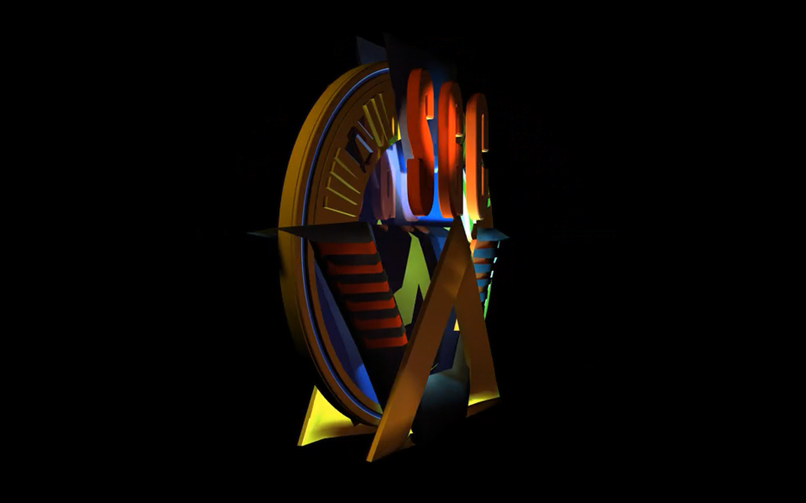

# SGC Screensaver

[](https://github.com/Luquas95/omarchy-SGC-screensaver/releases)
[](https://swaywm.org/)
[](https://www.gnu.org/software/bash/)
[](https://opensource.org/license/MIT)
[](https://github.com/Luquas95/omarchy-SGC-screensaver)

A custom screensaver for Sway/wlroots that replaces the stock idle screen
with a looping video of the Stargate Command logo, fullscreen on every
output, synchronized across monitors.



Originally built for [Omarchy](https://omarchy.org/) (Hyprland) — the
`legacy-hyprland/` folder keeps that version for reference — then rewritten
for plain Arch + Sway. The two ports work quite differently under the hood
(see "How it works" below), not just a find-and-replace of `hyprctl` with
`swaymsg`.

## Requirements

- Sway (`swaymsg`)
- `mpv`
- `jq`

```bash
sudo pacman -S mpv jq
```

`walker` is an optional soft dependency: the launch script quits it (`walker
-q`) before showing the screensaver so its overlay doesn't linger on top;
if you don't have it installed, that call just silently no-ops.

## Repository layout → target path

| File in repo                          | Target path                                     |
|----------------------------------------|--------------------------------------------------|
| `local-bin/sgc-launch-screensaver`     | `~/.local/bin/sgc-launch-screensaver`             |
| `local-bin/sgc-kill-screensaver`       | `~/.local/bin/sgc-kill-screensaver`               |
| `sgc-screensaver/sgc.mp4`              | `~/.local/share/sgc-screensaver/sgc.mp4`          |
| `sgc-screensaver/mpv-input.conf`       | `~/.local/share/sgc-screensaver/mpv-input.conf`   |
| `sway/sgc-idle.conf`                   | merge into `~/.config/sway/config` (see file)     |

## Installation

```bash
git clone https://github.com/Luquas95/omarchy-SGC-screensaver.git
cd omarchy-SGC-screensaver

mkdir -p ~/.local/bin ~/.local/share/sgc-screensaver

cp local-bin/sgc-launch-screensaver ~/.local/bin/
cp local-bin/sgc-kill-screensaver ~/.local/bin/
chmod +x ~/.local/bin/sgc-launch-screensaver ~/.local/bin/sgc-kill-screensaver

cp sgc-screensaver/sgc.mp4 ~/.local/share/sgc-screensaver/
cp sgc-screensaver/mpv-input.conf ~/.local/share/sgc-screensaver/
```

Then merge `sway/sgc-idle.conf` into your own `~/.config/sway/config` — see
that file for exactly what to add (a `swayidle` timeout clause plus a
`for_window` rule) and why it can't just be dropped in as a standalone
snippet. `sway reload` afterward.

## How it works

- `sgc-launch-screensaver` starts an `mpv` instance on every output via
  `swaymsg focus output <name>` + `swaymsg exec -- mpv ...`. Unlike
  Hyprland's `dispatch focusmonitor`, `swaymsg focus output` doesn't warp
  the real cursor — so unlike the old Hyprland version, there's no need for
  an IPC-socket sync dance between instances or a cursor-position watchdog
  to dodge false idle-resume triggers. `swayidle`'s `resume` handler (wired
  in `sway/sgc-idle.conf`) does the killing instead, plainly.
- Dismissal on key/click/scroll is handled by `mpv-input.conf`; plain mouse
  movement is caught by `swayidle`'s own idle-notify machinery, not by the
  script.
- The app ID is `org.sgc.screensaver` (own `for_window` rule in
  `sway/sgc-idle.conf`) — unlike the Hyprland version, which deliberately
  reused Omarchy's own screensaver window-rule class to piggyback on rules
  it already had (`.sgc`-suffixing that class used to break Omarchy's
  fullscreen windowrule for reasons not worth re-deriving there). Sway has
  no such existing rule to piggyback on, so this version just declares its
  own `app_id` and rule directly — one less moving part.
- `walker -q` is called first so Walker's own overlay (if it happened to be
  open) doesn't stay layered on top of the screensaver.

See `legacy-hyprland/` for how the original Hyprland version handled the
problems above differently (mpv IPC sockets + cursor-position watchdog +
`cursor.no_warps`), and the Omarchy `post-update` hook that re-applied
`hypridle.conf` after Omarchy migrations reset it — none of that applies
under plain Sway.

## Uninstallation

```bash
rm ~/.local/bin/sgc-launch-screensaver ~/.local/bin/sgc-kill-screensaver
rm -rf ~/.local/share/sgc-screensaver
```

Then remove the `timeout 150 ...` clause and the `for_window` rule from
`~/.config/sway/config` and `sway reload`.

## License

MIT, see [LICENSE](LICENSE).
